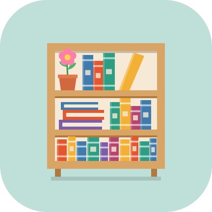
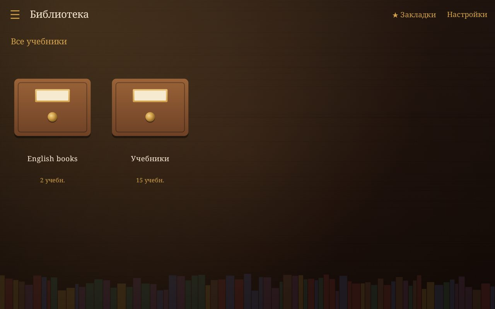
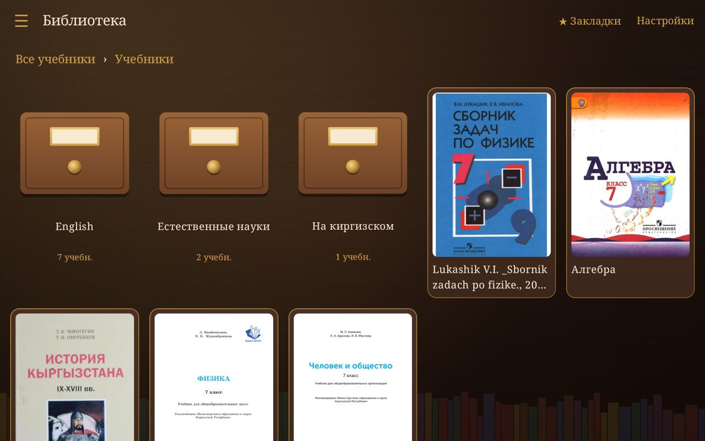
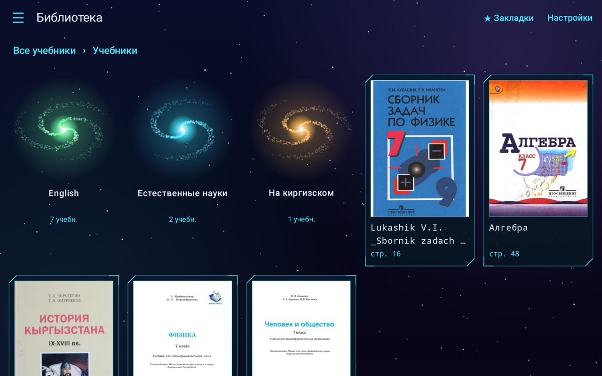
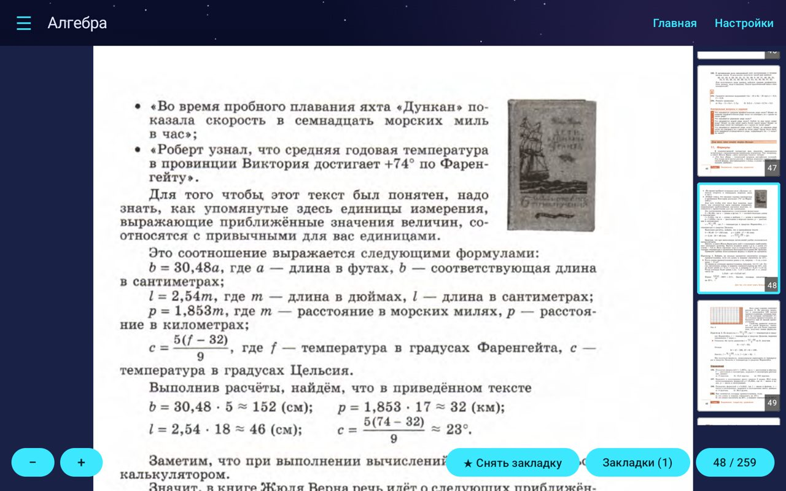

<p align="center"></p>

<h1 align="center">Читальня</h1>

<p align="center">
  Уютная читалка школьных учебников в PDF для Android-планшета.<br>
  Папки сохраняются, закладки подписываются, экран не гаснет.
</p>

<p align="center">
  🇷🇺 Русский · <a href="README.en.md">🇬🇧 English</a> · <a href="https://aleksandr-kai.github.io/chitalnya/">Презентация</a>
</p>

<p align="center">




</p>

---

## Что это

**Читальня** — бесплатное приложение для планшета, которое превращает папку с PDF-учебниками в аккуратную библиотеку. Укажите папку один раз, и приложение само разложит книги по полкам, повторяя структуру ваших папок.

## Возможности

- 📚 **Библиотека из папки** — выберите папку с учебниками, структура папок сохраняется в меню и на главном экране.
- 🖼 **Обложки** — книги показываются карточками с обложкой первой страницы, папки — отдельными плитками.
- 🔖 **Подписанные закладки** — сколько угодно закладок в книге, у каждой своя подпись; общий список закладок по всей библиотеке.
- 🔢 **Переход по номеру страницы** — тап по счётчику страниц.
- 💾 **Память** — книга открывается на странице, где вы остановились; масштаб запоминается отдельно для каждой книги и для вертикального/горизонтального режима.
- 🔍 **Масштаб** — щипок или кнопки, в вертикальном режиме по умолчанию «по ширине экрана».
- 🎞 **Лента превью** — справа от страницы, если остаётся свободное место: текущая страница в рамке, тап переключает страницу (отключается в настройках).
- 💡 **Экран не гаснет** во время чтения.
- 🖥 **Полноэкранный режим** — системные панели скрываются (настройка).
- 🎨 **Темы** — «Библиотека» (по умолчанию), «Фантастика» в стиле HUD-дашборда, светлая, тёмная и системная.

## Установка

Готового релиза в магазинах нет: приложение собирается из исходников.

1. Установите Android Studio или JDK 17 и Android SDK.
2. Подключите планшет по USB (включите отладку по USB).
3. Выполните:

```bash
./gradlew assembleDebug
adb install -r app/build/outputs/apk/debug/app-debug.apk
```

Требуется Android 8.0 (API 26) и новее.

## Как пользоваться

1. Откройте **Настройки** и выберите папку с учебниками.
2. Книги появятся на главном экране; папки открываются как «галактики» или «шкафы» в зависимости от темы.
3. Откройте книгу, листайте, масштабируйте, ставьте закладки.

Приложение только **читает** файлы и никуда их не отправляет: оно не просит доступ к интернету.

## Технологии

Kotlin · Jetpack Compose (Material 3) · Storage Access Framework · `PdfRenderer`.

## Лицензия

[PolyForm Noncommercial 1.0.0](LICENSE) — программу можно бесплатно использовать, изменять и передавать для **некоммерческих** целей. Коммерческое использование и продажа запрещены.

Если вам нужна коммерческая лицензия, свяжитесь с автором.
